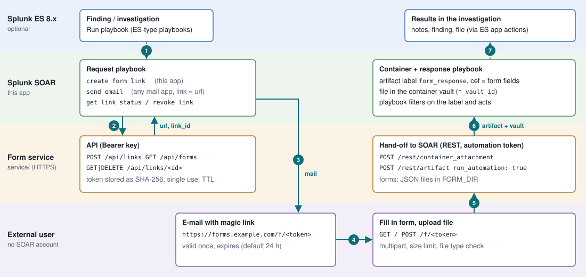

# Form Service – Splunk SOAR app

Send external people (no SOAR account) a **single-use magic link** to a **custom form with file upload**, and get
the answer back into the right SOAR container – as an artifact plus the file in the container vault – so playbooks
(and, with Splunk ES 8.x, the investigation) can continue automatically.



| Part | What it is | Where |
|---|---|---|
| SOAR app *Form Service* | Playbook side: `create form link`, `get link status`, `revoke link`, `list forms` | repo root |
| Form service | Small HTTPS web service that renders the form, validates the upload and hands it to SOAR | [`service/`](service/README.md) |
| Deployment example | One-command AWS deployment (EC2 + Caddy + Let's Encrypt) | [`deploy/aws/`](deploy/aws/README.md) |

Download the installable app from the [latest release](../../releases/latest) (`soar_form_service_v<version>.tar`).

## 1. Overview

**Form Service** (`soar_form_service`) lets SOAR playbooks send external people (without a SOAR account) a
**single-use magic link** to a custom form with **file upload**. The form itself is served by the separate form
service in [`service/`](service/README.md) of this repo. When someone submits it, the service
stores the files in the container vault and adds an artifact with label `form_response` to the container, using
`run_automation: true`, so active playbooks on the container continue.

This app is the playbook side: create a link, check its status, revoke it, list the available forms.

### Why a separate service and not SOAR itself

- SOAR app REST handlers (`/rest/handler/...`) require SOAR authentication before they run, so they cannot serve a
  public link to people without a SOAR account.
- The built-in prompt / secure link has no custom form and no file upload.
- Exposing the SOAR server to external users would widen its attack surface. The separate service only needs a
  public `/f/<token>` endpoint; the SOAR token stays on the service host.

### Flow

```
Playbook ──create form link──► Form service  POST /api/links ──► {link_id, url, expires_at}
Playbook ──send email (url)──► external user ──► GET/POST /f/<token>
Form service ──vault upload + artifact (label form_response)──► SOAR container
Playbook ──get link status / revoke link──► Form service
```

### Use with Splunk Enterprise Security 8.x

When SOAR is paired with ES, each finding/investigation has a hidden SOAR container. Run the request playbook as an
**ES-type playbook** from the investigation (tab *Automation*), pass `container_id` = `container:id`, and write
results back with the *Enterprise Security* app actions (e.g. `add finding or investigation note` with
`id = finding:investigation_guid`, `add investigation file`) – native SOAR notes are not shown in ES. Custom fields
of manually created findings carry the prefix `custom_col_` (e.g. `finding:consolidated_findings.custom_col_recipient_email`).

### Forms are templates

Each form is a JSON file in the service's `FORM_DIR` (`service/forms/<name>.json`); the `form` parameter of
`create form link` selects it. Field types: `text`, `email`, `textarea`, `select`, `file` (one file per file field).
Per form you set title, description, artifact `label`, and per field label, required, `options`, `max_length` and
`accept` (file extensions). See [`service/forms/evidence_upload.json`](service/forms/evidence_upload.json).

### Security notes

- Link tokens are random (`token_urlsafe(32)`), stored only as SHA-256, single use and expiring.
- Only `/f/*` (and `/healthz`) need to be public. Restrict `/api/*` to the SOAR host at your reverse proxy where
  possible; it is protected by the Bearer key in any case.
- Not included: malware scanning of uploads, rate limiting, binding a link to a person. Add them in front of or
  after the service if your environment requires them.

### Form service host – requirements

The form service is the only part that must be reachable from the internet. It is deliberately small:

| Item | Requirement |
|---|---|
| Runtime | Python ≥ 3.11, standard library only (no `pip install`) – **or** Docker with the included `service/Dockerfile` (`python:3.13-slim`) |
| OS / CPU | Any OS that runs Python or Docker; amd64 or arm64 |
| Sizing | Tested on AWS `t4g.nano` (2 vCPU, 0.5 GB RAM + swap). Recommended: 1 vCPU, ≥ 0.5 GB RAM, 1–2 GB disk |
| Memory per upload | An upload is held in memory while it is validated and sent to SOAR; plan RAM for `FORM_MAX_MB` (default 10 MB) × parallel submissions |
| Disk / state | Only `links.db` (SQLite, token hashes and link status) in `FORM_STATE_DIR`; uploaded files are **not** stored on the host. Keep the state directory when moving hosts, otherwise open links become invalid |
| Inbound network | HTTPS 443 from the internet to `/f/*` (form) – via a reverse proxy with a valid certificate (e.g. Caddy or nginx with Let's Encrypt). `/api/*` only from the SOAR host. Port 80 only for the ACME challenge / redirect |
| Outbound network | HTTPS from the service host to the SOAR REST API (`SOAR_URL`) |
| DNS / name | A public host name for `FORM_BASE_URL` (own domain, or `<ip-with-dashes>.sslip.io` for tests) |
| SOAR account | Automation user with permission to add artifacts and vault files to the target containers; its token is `SOAR_TOKEN` |
| Secrets | `FORM_API_KEY` (shared with the SOAR asset) and `SOAR_TOKEN` – keep them in a secret store (the AWS example uses SSM Parameter Store), never in the image |
| Service listens on | `FORM_HOST:FORM_PORT` (default `127.0.0.1:8080`, container `0.0.0.0:8080`); not exposed directly, only through the proxy |
| Forms | JSON files in `FORM_DIR`; in the Docker image they are copied at build time – mount `FORM_DIR` as a volume to change forms without rebuilding |

Minimal run without Docker:

```bash
cd service
FORM_BASE_URL=https://forms.example.com FORM_API_KEY=<random-key> \
SOAR_URL=https://soar.example.com SOAR_TOKEN=<automation-token> \
python3 -m soar_form        # listens on 127.0.0.1:8080, put a TLS reverse proxy in front
```

AWS in one command (EC2 arm64, Amazon Linux 2023, Docker, Caddy with Let's Encrypt, secrets in SSM):
see [`deploy/aws/README.md`](deploy/aws/README.md).

## 2. Prerequisites

- Splunk SOAR On-Premises with Python 3.13 app runtime (8.x; built for 8.7). The manifest declares
  `python_version: "3.13"`.
- A running form service reachable from the SOAR host over HTTPS, with its API key (`FORM_API_KEY`) – see
  [Form service host – requirements](#form-service-host--requirements).
- The form service itself needs a SOAR automation user token to write vault files and artifacts.

## 3. Binary/System Installation

None. The app only uses the Python standard library; there are no `pip3_dependencies` and no system binaries.

## 4. App Installation

1. Build the package: `scripts/package.sh` → `releases/soar_form_service_v<version>.tar`.
2. In SOAR: **Apps → Install App** → upload the TAR.
3. **Configure New Asset** for *Form Service*:

| Field | Required | Default | Description |
|---|---|---|---|
| `base_url` | yes | – | Base URL of the form service, e.g. `https://forms.example.com` |
| `api_key` | yes | – | API key of the form service, sent as `Authorization: Bearer` |
| `verify_server_cert` | no | `true` | Verify the TLS certificate (switch off only for lab certificates) |
| `timeout` | no | `30` | Request timeout in seconds |

### Using the app in another environment

The app contains no host names, keys or customer specifics; everything environment-specific is configuration:

| What | Where | Per environment |
|---|---|---|
| Form service URL and key | Asset `base_url`, `api_key` | yes |
| TLS trust | Asset `verify_server_cert` or CA on the SOAR host | yes |
| SOAR URL and automation token for the service | Service env `SOAR_URL`, `SOAR_TOKEN` | yes |
| Public URL of the links | Service env `FORM_BASE_URL` | yes |
| Forms (fields, label, accepted file types) | Service `forms/<name>.json` | as needed |
| Playbook label filter (`form_response`) | Form JSON `label` and playbook filter | keep in sync |

Steps: deploy the form service from `service/` (Python or `Dockerfile`) with its own env and forms, install the TAR,
create the asset, run Test Connectivity.

## 5. Test Connectivity

**Test Connectivity** calls `GET /healthz` (reachability, no key) and `GET /api/forms` (key check). Success shows
`API key accepted, N form(s) available` and `Test Connectivity Passed`. A wrong key fails with
`Form service HTTP 401: API key rejected`.

## 6. Actions

### create form link
Create a single-use magic link to a form. The response arrives later as an artifact in the container.

| Parameter | Type | Required | Description |
|---|---|---|---|
| `form` | string | yes | Form name, see `list forms` |
| `container_id` | numeric | no | Container that receives the response (default: current container) |
| `ttl_minutes` | numeric | no | Link lifetime in minutes (default: service default, 24 h) |

| Data path | Type | Contains |
|---|---|---|
| `action_result.data.*.link_id` | string | `form link id` |
| `action_result.data.*.url` | string | `url` |
| `action_result.data.*.expires_at` | numeric | Unix time |
| `action_result.data.*.form` | string | |
| `action_result.data.*.container_id` | numeric | |
| `action_result.summary.link_id` | string | |

### get link status
| Parameter | Type | Required | Description |
|---|---|---|---|
| `link_id` | string (`form link id`) | yes | ID from `create form link` |

| Data path | Type | Notes |
|---|---|---|
| `action_result.data.*.status` | string | `open`, `claimed` (submission in progress), `used`, `revoked`, `expired` |
| `action_result.data.*.link_id`, `.form`, `.container_id` | | |
| `action_result.data.*.created_at`, `.expires_at`, `.used_at` | numeric | Unix time, `used_at` empty until used |
| `action_result.summary.status` | string | |

### revoke link
Revokes an **open** link; afterwards the form page answers "link invalid". Used or in-progress links keep their
status. Parameters and output as for `get link status`.

### list forms
No parameters. One data item per form:

| Data path | Type |
|---|---|
| `action_result.data.*.name` | string |
| `action_result.data.*.title` | string |
| `action_result.data.*.fields.*.name` / `.type` / `.required` | string / string / boolean |
| `action_result.summary.total_forms` | numeric |

### Playbook pattern
`create form link` → `send email` with `create_form_link:action_result.data.*.url` → separate playbook on the same
container filtered on `artifact:*.label == form_response` reads the fields and `<field>_vault_id`. Optional:
`get link status` or `revoke link` from a timer or when the case closes.

## 7. Widget Display

No custom widget. All actions use the standard table view (`render: table`).

## 8. Local Testing

```bash
python3 -m unittest discover -s tests -t .     # all tests (manifest, client, connector, integration)
ruff format . && ruff check .
scripts/package.sh                             # builds and lists the TAR
```

- `tests/fake_phantom.py` replaces the `phantom` package, so the connector runs without SOAR.
- `tests/test_integration.py` starts the real form service from `service/` (override: `$FORM_SERVICE_SRC`) with a
  fake SOAR.
- `scripts/check.sh` runs lint, app tests and service tests in one go.
- On a SOAR host: `python3 soar_form_service_connector.py <action.json>` with a standard SOAR action JSON.

## 9. Troubleshooting

| Message | Cause / fix |
|---|---|
| `Asset configuration invalid: base_url must start with http:// or https://` | Fix `base_url` in the asset |
| `Form service not reachable at …` | DNS, firewall or proxy between SOAR and the service; check `GET /healthz` from the SOAR host |
| `Form service HTTP 401: API key rejected` | `api_key` differs from `FORM_API_KEY` of the service |
| `Form service answered with redirect 30x` | `base_url` points to a redirect (e.g. http → https); use the final URL. Redirects are refused so the key never leaves the configured host |
| Install: `incompatible Python version … App versions: [3.9]` | Manifest `python_version` must name the SOAR runtime explicitly (`"3.13"`); `"3"` is read as 3.9 |
| `Form service response misses 'link_id'` | Service version without the link API (`link_id`, status, revoke); update it |
| `Invalid link_id` | Pass the `link_id` from `create form link`, not the URL |
| TLS error | Lab certificate: set `verify_server_cert` to false, or install the CA on the SOAR host |

## 10. Changelog

| Version | Date | Change |
|---|---|---|
| 1.0.1 | 2026-11-19 | License: Apache 2.0 (LICENSE, manifest, README) |
| 1.0.0 | 2026-11-19 | First public release: test connectivity, create form link, get link status, revoke link, list forms; form service and AWS deployment example |

## License

Copyright 2026 Andreas Buis. Licensed under the [Apache License, Version 2.0](LICENSE).
